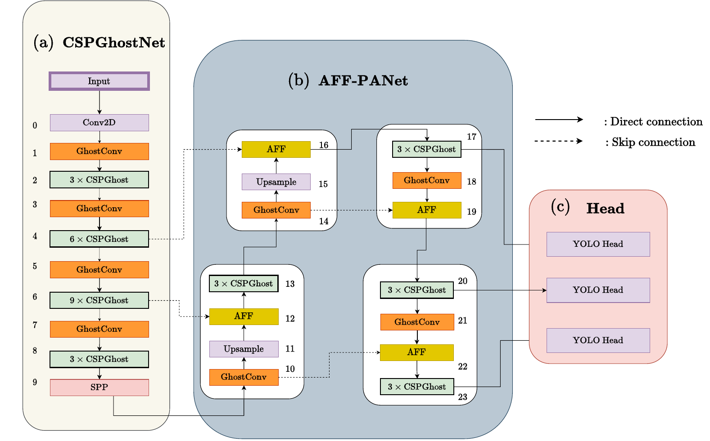

# YOGA: Lightweight Object Detection for Edge Devices

[](https://doi.org/10.1016/j.patcog.2023.109451)
[](https://arxiv.org/abs/2307.05945)
[](LICENSE)
[](https://colab.research.google.com/github/TrustAIoT/YOGA_object-detection/blob/main/YOGA_quickstart.ipynb)
[](https://github.com/TrustAIoT/YOGA_object-detection/actions/workflows/ci.yml)

Official code, configs and pretrained COCO weights for

> **YOGA: Deep Object Detection in the Wild with Lightweight Feature Learning and Multiscale Attention**
> Raja Sunkara and Tie Luo. *Pattern Recognition*, 139:109451, 2023.
> [Paper](https://doi.org/10.1016/j.patcog.2023.109451) · [arXiv](https://arxiv.org/abs/2307.05945)

YOGA is a YOLO-style detector built for low-end edge hardware (tested on an NVIDIA Jetson Nano). It makes two changes to a YOLOv5-style network:

* **CSPGhostNet backbone.** Ghost convolutions learn half of each layer's feature maps with ordinary convolutions and produce the other half with cheap linear operations, so every stage uses about half the filters.
* **AFF-PANet neck.** Multi-scale features are fused with attentional feature fusion (iAFF) instead of plain concatenation.

Across 10+ detectors on COCO, YOGA gives the best trade-off between size and accuracy: up to 22% higher AP with 23–34% fewer parameters and FLOPs.



## Results on COCO val2017 (640×640)

| Model | AP | AP<sub>S</sub> | Params (M) | FLOPs (B) |
|---|:-:|:-:|:-:|:-:|
| YOGA-n | 32.3 | 15.2 | 1.9 | 4.9 |
| YOGA-s | 40.7 | 23.0 | 7.6 | 16.6 |
| YOGA-m | 45.2 | 28.0 | 16.3 | 34.6 |
| YOGA-l | 48.9 | 31.8 | 33.6 | 71.8 |

Pretrained weights: [Google Drive folder](https://drive.google.com/drive/folders/1K2rKYY9p3wmA6-rN0Jx8g_6pBazyGZjO). Put the files in the repository root as `YOGA-n.pt`, `YOGA-s.pt`, `YOGA-m.pt` and `YOGA-l.pt`.

## Install

Python 3.8 or newer, PyTorch 1.13 or newer (tested with PyTorch 2.14 and NumPy 2.x).

```bash
git clone https://github.com/TrustAIoT/YOGA_object-detection
cd YOGA_object-detection
pip install -r requirements.txt
```

## Quick start

The fastest way to try YOGA is the [Colab notebook](https://colab.research.google.com/github/TrustAIoT/YOGA_object-detection/blob/main/YOGA_quickstart.ipynb): no install, and it covers detection, PyTorch Hub, validation and fine-tuning. To run locally:

Detect objects in images, videos, folders or a webcam:

```bash
python detect.py --weights YOGA-s.pt --source path/to/images   # results go to runs/detect/
```

Or from Python through PyTorch Hub:

```python
import torch

model = torch.hub.load("TrustAIoT/YOGA_object-detection", "custom", path="YOGA-s.pt")
results = model("https://ultralytics.com/images/zidane.jpg")
results.print()
```

## Evaluate

```bash
bash data/scripts/get_coco.sh   # COCO 2017 into ../datasets/coco
python val.py --weights YOGA-n.pt --data data/coco.yaml --img 640 --iou 0.65 --half --batch-size 1
```

Replace `YOGA-n.pt` with the s, m or l weights for the other rows of the table.

## Train

```bash
# YOGA-n
python train.py --data coco.yaml --cfg models/YOGA-n.yaml --hyp data/hyps/YOGA-n.yaml --weights '' \
  --batch-size 128 --epochs 300 --sync-bn --project YOGA --name YOGA-n --label-smoothing 0.01
# YOGA-s
python train.py --data coco.yaml --cfg models/YOGA-s.yaml --hyp data/hyps/YOGA-s.yaml --weights '' \
  --batch-size 128 --epochs 300 --sync-bn --project YOGA --name YOGA-s --linear-lr
# YOGA-m
python train.py --data coco.yaml --cfg models/YOGA-m.yaml --hyp data/hyps/YOGA-m.yaml --weights '' \
  --batch-size 64 --epochs 300 --sync-bn --project YOGA --name YOGA-m
# YOGA-l
python train.py --data coco.yaml --cfg models/YOGA-l.yaml --hyp data/hyps/YOGA-m.yaml --weights '' \
  --batch-size 20 --epochs 250 --sync-bn --project YOGA --name YOGA-l
```

To train on your own dataset, write a dataset YAML in the YOLOv5 format (see `data/coco128.yaml`), pass it with `--data`, and start from a COCO checkpoint with `--weights YOGA-s.pt`.

## Use YOGA's blocks in your own detector

The blocks are ordinary PyTorch modules: `C3Ghost` and `GhostConv` in [`models/common.py`](models/common.py), and `iAFF` and `AFF` in [`models/new_models.py`](models/new_models.py). In a YOLOv5-style model YAML, swap a concatenation for attentional fusion like this:

```yaml
[[-1, 6], 1, Concat, [1]],   # YOLOv5 neck
[[-1, 6], 1, iAFF, [1]],     # YOGA neck
```

See [`models/YOGA-s.yaml`](models/YOGA-s.yaml) for the full network. If you use these blocks, please cite the paper.

## Export

```bash
python export.py --weights YOGA-n.pt --include onnx    # also torchscript, coreml, saved_model, pb, tflite, tfjs
```

## Troubleshooting

**`AttributeError: 'Upsample' object has no attribute 'recompute_scale_factor'`.** This happens when a checkpoint saved with an older PyTorch is loaded with a newer one. `attempt_load` in `models/experimental.py` now patches this automatically. If you load a checkpoint some other way and still see the error, follow the fix in [this YOLOv5 issue comment](https://github.com/ultralytics/yolov5/issues/6948#issuecomment-1075528897).

**`_pickle.UnpicklingError: Weights only load failed`.** PyTorch 2.6+ refuses to unpickle full models by default. Load checkpoints through `attempt_load` (as `detect.py` and `val.py` do), or pass `weights_only=False` to `torch.load` for checkpoints you trust.

## Citation

```bibtex
@article{sunkara2023yoga,
  title   = {{YOGA}: Deep Object Detection in the Wild with Lightweight Feature Learning and Multiscale Attention},
  author  = {Sunkara, Raja and Luo, Tie},
  journal = {Pattern Recognition},
  volume  = {139},
  pages   = {109451},
  year    = {2023},
  doi     = {10.1016/j.patcog.2023.109451}
}
```

GitHub's "Cite this repository" button (from [`CITATION.cff`](CITATION.cff)) gives the same reference.

## Acknowledgements

The training, evaluation and export code builds on [YOLOv5](https://github.com/ultralytics/yolov5) by Ultralytics (GPL-3.0).
